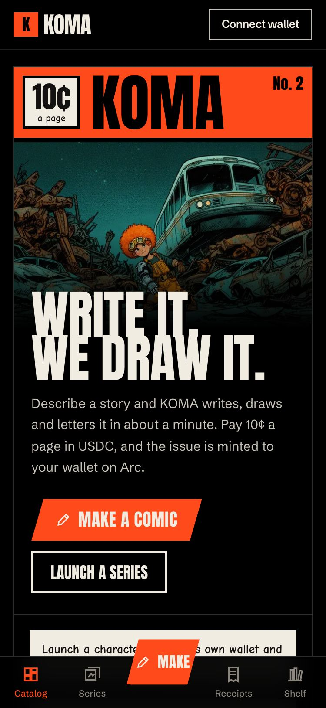
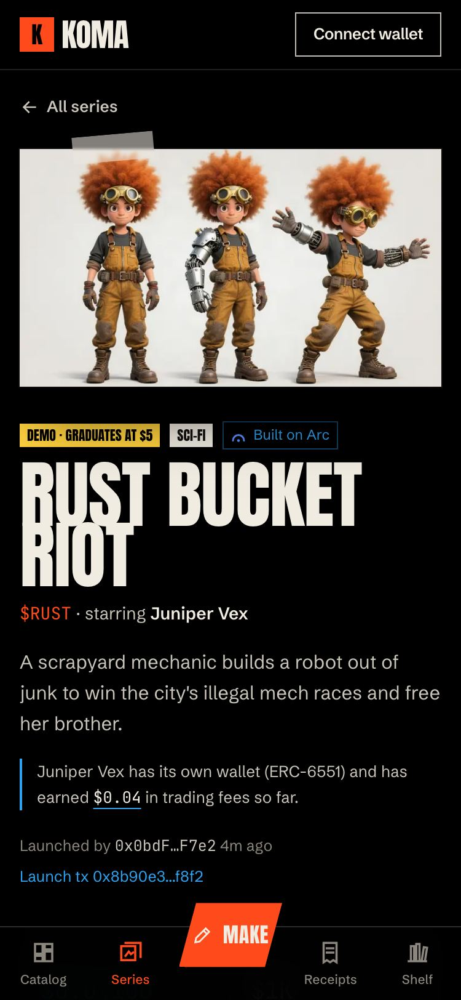
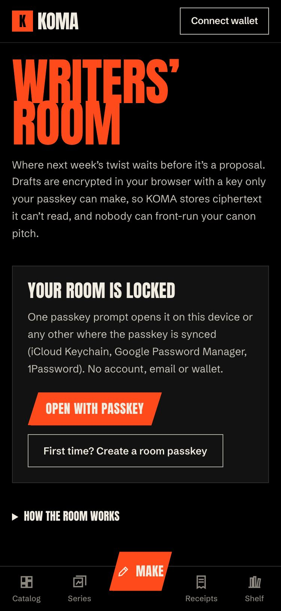
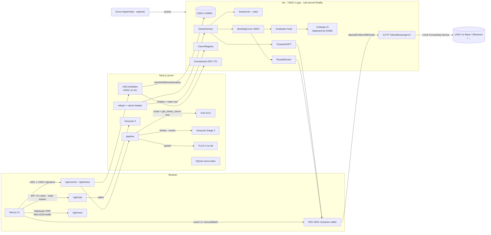

# KOMA on Arc

**Comics fans own, and characters whose stories their holders write — paid, traded and settled in USDC on Arc.**

Describe a story and KOMA's AI editor (Tencent **Hunyuan 3**) shapes it into a pitch; **Kimi K2.6** writes the
script and fal draws it (character sheets and covers by **Hunyuan Image 3**). You pay a few cents of **USDC on Arc**
with one signature (x402, no gas); the payment is final in under a second, and the finished issue is minted to you. Launch its hero as a
**series**: a Character NFT with its own ERC-6551 wallet, a coin on a USDC bonding curve, and a canon that holders
vote on. The character earns 40% of every trading fee in USDC, and whoever holds it can send those earnings to any
CCTP chain in one transaction.

[Submission](SUBMISSION.md) · [Mainnet runbook](MAINNET.md) · [Security review](contracts/AUDIT.md) · [Spec](contracts/LAUNCHPAD_SPEC.md) · MIT

| Home (phone) | A series: coin, canon, character wallet | Writers' Room |
|---|---|---|
|  |  |  |

## What KOMA uses Arc for

| Arc / Circle primitive | Where it shows up in KOMA |
|---|---|
| **USDC as the gas token** | USDC is the only token anyone ever holds. Readers pay, backers trade, creators launch, all in USDC; the relayer, the x402 facilitator and the keeper pay their gas in the same USDC, so KOMA's whole cost base is in dollars. The rare wallet-sent transaction (selling into a graduated pool, withdrawing a character's earnings) costs a fraction of a cent of USDC, never a second token. |
| **x402 over Arc's USDC (EIP-3009)** | Comics ($0.10/page) and series launches ($1) are HTTP 402 payments: one `TransferWithAuthorization` signature on Arc's USDC (`USDC`/`2` EIP-712 domain), settled by KOMA's own x402 facilitator (`/api/facilitator/*`, usable by other apps). AI agents buy comics the same way from a script. |
| **Gasless trading via `receiveWithAuthorization` + permit** | A buy on a bonding curve is one USDC `ReceiveWithAuthorization` whose nonce commits to the curve, amount, minimum out and deadline; a sell is a permit plus a signed intent. KOMA's relayer submits them. On Arc a relayed buy costs ~0.008 USDC of gas, so gasless trading pays its way from **$1** (it was $3 on the source chain). |
| **Sub-second deterministic finality** | A payment's receipt is final, so the studio starts drawing the moment the facilitator's transaction lands, and a mint confirms in under a second. No confirmation counts anywhere in the code. |
| **CCTP V2 + Forwarding Service** | A character's ERC-6551 wallet sends its USDC earnings to Base, Ethereum, Arbitrum, OP or Avalanche: the Character NFT's owner signs one Arc transaction (`executeBatch`: approve + `depositForBurnWithHook` with the `cctp-forward` hook) and Circle mints on the destination. The owner never needs gas or an RPC on the other chain. |
| **Arc's EVM, as is** | Uniswap v4 (PoolManager, PositionManager, V4Quoter) isn't on Arc, so the deploy script deploys Uniswap's own bytecode; the ERC-6551 registry and Tokenbound v0.3 are replayed at their canonical addresses through the deterministic deployer. The contracts never touch native value, `PREVRANDAO` or `SELFDESTRUCT` (see the [Arc port review](contracts/AUDIT.md#arc-port-review-2026-10-07)). |

## Architecture



- **Contracts** (`contracts/`, Foundry, solc 0.8.28): `KomaIssues` (one ERC-721 per issue, bound to the x402
  payment tx that bought it), `SeriesFactory` (one transaction mints the Character NFT + its Tokenbound wallet, a
  1B-supply `SeriesCoin` with 5% vesting to the creator, and its `BondingCurve`), `CurveMathReference`,
  `RoyaltyRouterReference` (1.5% fee: 40% character, 20% up the remix tree, 40% treasury), `CanonRegistry`,
  `Graduator` (an initialize-only Uniswap v4 hook that seeds a locked full-range pool), `KomaSwapper` (gasless buys
  after graduation).
- **Server** (`src/lib/server/`): x402 resource server + facilitator, the AI pipeline (Kimi, Hunyuan, fal), the
  relayer and canon keeper, and an in-process event index (SQLite). The keeper tallies the EIP-712 votes and writes
  the winner plus a root of every vote on chain; anyone can re-check it from `/api/canon/[series]`.
- **Writers' Room** (`/room`): one passkey, keys that are not a wallet. WebAuthn PRF under KOMA's own salt → HKDF →
  an Ed25519 room identity and an AES-256-GCM drafts key; the server stores ciphertext only.
- **Indexer** (`indexer/`, optional): Envio HyperIndex for the leaderboard, over Arc's RPC or Envio's HyperSync for Arc.

## Addresses (Arc testnet, chain 5042002)

From [`deployments/arc-testnet.json`](deployments/arc-testnet.json) (with proof transactions under `proof`). Explorer:
<https://explorer.testnet.arc.io>.

<!-- addresses:start -->
_Not deployed yet: the testnet deploy is waiting for the deployer wallet to be funded. `sh scripts/deploy.sh testnet`
then `node scripts/addresses-md.mjs` fills this table. Canonical contracts KOMA uses on Arc: USDC
`0x3600000000000000000000000000000000000000`, CCTP TokenMessengerV2 `0x8FE6B999Dc680CcFDD5Bf7EB0974218be2542DAA`
(testnet) / `0x28b5a0e9C621a5BadaA536219b3a228C8168cf5d` (mainnet), ERC-6551 registry
`0x000000006551c19487814612e58FE06813775758`, Permit2 `0x000000000022D473030F116dDEE9F6B43aC78BA3`._
<!-- addresses:end -->

Arc mainnet (chain 5042): [`deployments/arc-mainnet.json`](deployments/arc-mainnet.json) is written by
`NETWORK=mainnet sh scripts/deploy.sh` — see [MAINNET.md](MAINNET.md).

## Run it locally against Arc testnet

Needs Node ≥ 22.13 and Foundry.

```bash
npm install
sh scripts/testnet-setup.sh       # local test keys in .env.local; funds them if ../.deployer/deployer.env exists
echo "FAL_KEY=<your fal key>" >> .env.local   # Kimi + Hunyuan through fal, art on fal (or MOONSHOT_API_KEY + HUNYUAN_API_KEY + FAL_KEY)
npm run demo                      # builds and serves http://localhost:4310 against deployments/arc-testnet.json
```

Get testnet USDC (which is also the gas) from <https://faucet.circle.com> → Arc Testnet. Connect any injected wallet
(MetaMask, Rabby, Coinbase Wallet); the app adds Arc testnet itself. Without AI keys the studio says it isn't
configured; trading, voting and the Writers' Room still work.

No testnet USDC yet? `sh scripts/local-fork.sh` forks Arc testnet with Arc Foundry's `arc-anvil` (which, unlike plain
anvil, moves Arc's native USDC), deploys the same contracts and funds the test wallets; the header of that script
shows how to point the app and the e2e suites at it.

Deploying your own copy: `sh scripts/deploy.sh testnet` (reads the deployer key from `DEPLOYER_ENV`, default
`../.deployer/deployer.env`; `DRY_RUN=1` simulates against the live chain).

## What you can do

- **Make a comic.** Chat with the Hunyuan editor (or use the form), agree a pitch, sign once. Kimi writes the
  script, FLUX.2 draws the panels, and the issue is minted as an ERC-721 that commits to the exact pages. If a model
  gives up after you've paid, **Try again** resumes it with no second charge.
- **Launch a series ($1).** Hunyuan Image 3 draws a character sheet. One transaction then mints the Character NFT
  with an ERC-6551 wallet, a 1B-supply Series Coin (5% vesting to you) and its USDC bonding curve. On testnet a
  *demo series* graduates at 5 USDC with 5-minute votes, so one faucet drip takes it all the way to a v4 pool.
- **Trade without gas.** A buy is one USDC signature; a sell is a permit plus a signed intent. KOMA's relayer
  submits them from $1 up.
- **Write the canon.** Holders (≥1M coins, or the character's owner) propose the next episode, drawn on-model from
  the character sheet. Kimi reads the voted canon (`get_series_canon` tool call) before writing it. Holders vote
  for free with an EIP-712 signature weighted at a snapshot; the keeper finalizes on chain with a votes root.
- **Earn as a character, cash out anywhere.** 40% of every 1.5% fee lands in the character's own wallet, and
  remixes pay up the tree. The holder withdraws to their Arc wallet, or to another chain over CCTP.
- **Keep secrets in the Writers' Room** until they're pitched.

## Tests

```bash
cd contracts && forge test        # 161 unit + fuzz tests (Circle FiatToken v2.2 at Arc's USDC address, real Tokenbound, real Uniswap v4)
npm run test:unit                 # prompt softener
npm run typecheck && npm run lint && npm run build
# Against Arc testnet with the app running (npm run demo):
npm run test:api        # x402 + issues: real USDC payments, real models, minted on Arc
npm run test:launchpad  # launch → gasless trades → canon → remix royalties → graduation into v4 → CCTP withdrawal
npm run test:browser    # the main flows through the UI with real signatures
npm run test:walk       # every page at 375 px      npm run test:ai   # model credits, Kimi tool call
npm run test:room       # Writers' Room (virtual WebAuthn PRF authenticator)
```

The e2e suites record their transaction hashes in `deployments/arc-testnet.json` → `proof`. The latest run is in
[SUBMISSION.md](SUBMISSION.md#evidence).

## Repository

```
src/          Next.js app: pages, API routes, studio, launchpad UI, Writers' Room; server: x402, pipeline, relayer, keeper, index
contracts/    Foundry: KomaIssues, launchpad; unit/fuzz tests; DeployLaunchpad (Arc testnet + mainnet); script/erc6551 init code
deployments/  arc-testnet.json (addresses + proof txs), arc-mainnet.json (after the mainnet deploy)
indexer/      Envio HyperIndex (optional): config generated from deployments/, schema, handlers
scripts/      deploy / verify / testnet-setup / demo, e2e suites, wallet shim
```

## Known limits

- SQLite and on-disk art mean one server instance on a persistent volume, with the pipeline in-process.
- The canon tally runs on KOMA's server; the published votes root makes a wrong tally detectable, not impossible.
- The Uniswap v4 contracts on Arc are deployed by KOMA (Uniswap's bytecode, unmodified), not by Uniswap Labs.
- No pause and no upgrades, by design: a contract bug means deploying a new factory.

## AI tools disclosure

**Claude Code** (Anthropic) wrote most of the code, tests and docs, under the author's direction and review. At
runtime KOMA uses **Kimi K2.6** (scripts), **Hunyuan 3** (editor), **Hunyuan Image 3** and **FLUX.2** (art).


### Gateway funding (opt-in, not funded end-to-end verified)

Set `NEXT_PUBLIC_FEATURE_GATEWAY=1` and rebuild to enable `/fund`, the wallet's Fund link, and `/api/gateway`. With the flag absent both API methods fail closed with 503. The flow quotes a same-wallet USDC transfer from a pre-existing Circle Gateway deposit to Arc using Circle's current fee and block-height estimate. The user approves the exact EIP-712 intent; the API verifies that signature and fetches Circle's attestation. The user then submits `gatewayMint` from their own Arc wallet; KOMA has no server signing key in this path. Users need existing Arc USDC for mint gas. Amounts are limited to 1,000 USDC and quote maximum fees to 10 USDC.

The original signed intent is saved per chain and wallet before contacting Circle. The server records uncertainty before submission and persists accepted attestations in `KOMA_DATA_DIR/gateway` before replying. Resume recovers a lost browser response without another submission or signature. Submitted mint hashes are saved and checked for an actual successful receipt after reload; rejected mints retain the attestation. One server writer per data directory is required. Circle transfer IDs are retained: recovery uses Circle’s documented `GET /v1/transfer/{id}`, checks the original packed TransferSpec hash and reads its nested attestation. A timeout upstream before any transfer ID is received remains ambiguous; the UI blocks another authorization and preserves an exportable original intent for Circle support. It never claims success or automatically repeats that submission. Do not enable this feature for production until a funded source deposit, signed transfer, interrupted-request recovery and destination mint have been rehearsed. No funded cross-chain transfer was performed during the local takeover checks. CCIP message/receipt integration remains queued; Circle Gateway is not CCIP and Arc's native USDC must not be presented as a CCIP token.

Sources: [Circle contract addresses](https://developers.circle.com/gateway/references/contract-addresses), [estimate API](https://developers.circle.com/api-reference/gateway/all/estimate-transfer), [transfer flow](https://developers.circle.com/gateway/howtos/transfer-unified-usdc-balance).


### CCIP canon receipts (message-only, not deployed)

`contracts/src/ccip/KomaCanonSender.sol` publishes the actual finalized `CanonRegistry.slot` winner and that `KomaIssues.issue` content/payment hashes. Its owner configures a supported chain selector and remote receiver; the caller pays the exact native router fee. CCIP token arrays are empty: this does not transfer Arc native USDC or series coins. `KomaCanonReceipt.sol` accepts only its configured CCIP router and owner-allowlisted source selector/sender pairs, rejects token-bearing messages, duplicate message IDs and conflicting canon receipts. Stored receipts are namespaced by source chain, sender, series and episode. These are receipts, not authority to mint NFTs, spend USDC or finalize local votes.

Install the pinned official contracts package with `npm --prefix contracts ci --ignore-scripts`, then `cd contracts && forge test --match-path 'test/ccip/KomaCanonCcip.t.sol' --threads 1`. Five local tests verify finalized onchain reads, exact fee/no tokens, router/source/sender authentication, replay/conflict/version rejection and owner/supported-route configuration. No real CCIP send or deployment was performed. Deploy/configure source and receiver against verified router addresses/selectors, rehearse the lane, before presenting CCIP delivery as live.

Gateway recovery reference: [Circle transfer lookup](https://developers.circle.com/api-reference/gateway/all/get-transfer-by-id); identifier encoding: [Circle TransferSpec source](https://github.com/circlefin/evm-gateway-contracts/blob/master/src/lib/TransferSpec.sol).


The public `/receipts` page now includes a read-only CCIP canon section backed by `GET /api/ccip/receipts`. Set `KOMA_CCIP_RECEIPTS_ENABLED=1`, `KOMA_CCIP_RECEIPT_RPC_URL`, `KOMA_CCIP_RECEIPT_CHAIN_ID`, and `KOMA_CCIP_RECEIPT_ADDRESS` only after deploying the receiver on that chain. There are no default addresses, chain substitutions, wallet connections or signing keys in this reader. It verifies RPC chain ID, receiver bytecode, router, accepted-message flags and stored issue/content/payment hashes against actual `CanonReceived` events. It shows at most25 receipts from the most recent1,000 blocks and explicitly labels this window instead of presenting a full index. Missing configuration shows not configured; read failures show unavailable and API502. Configured empty ranges show no receipts found. Receiver deployment, correct allowlists and actual lane delivery remain the external verification gates. Five reader tests pass with mocked RPC; no deployed receipt was claimed. Production builds are capped to two page-generation workers.


### Container release preparation

The Docker build accepts `NEXT_PUBLIC_FEATURE_GATEWAY` with default0 and uses the validated webpack build. Source env files and nested contract dependencies are excluded from upload/build context. Runtime runs as the node user and keeps SQLite/art/Gateway recovery state under `/data`; attach a persistent Railway volume there before paid operation. `railway.json` uses `/api/health` for process liveness, not funded/AI/deployment readiness. Set runtime signing/provider credentials separately only after deployment bytecode and funded tests are verified; local fork fixture keys are not production configuration. CI installs the pinned CCIP contracts dependencies before Forge. Existing Arbitrum Railway services must not be reused for this Arc release.

Railway fresh volumes are root-owned. The container entrypoint initializes `/data` ownership and immediately uses `gosu` to run the app as node; it does not keep the web process running as root.
